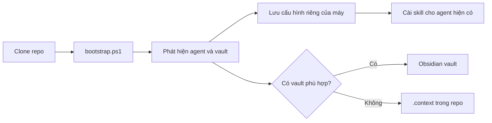

# 🧠 hd-skill

> **Một bộ skill, hai coding agent, bộ nhớ ngữ cảnh dùng lại được.**
> Dành cho Windows · Viết bằng PowerShell · Cấu hình theo từng máy

[](https://www.microsoft.com/windows)
[](https://learn.microsoft.com/powershell/)
[](https://github.com/openai/codex)
[](https://antigravity.google/)
[](https://github.com/LeDuyCoder/hs-skills)

`hd-skill` là bộ skill dùng chung cho Codex và Google Antigravity trên Windows. Repo chứa skill, rules, mẫu note và script; cấu hình riêng của máy nằm ở `%USERPROFILE%\.hd-skill\config.json`. Repo không chứa đường dẫn vault của một máy cụ thể.

| ✨ Một nguồn chung | 🧭 Tự phát hiện | 🔒 An toàn mặc định |
|---|---|---|
| Cài skill từ cùng repo vào Codex và Antigravity | Chọn agent, vault và đường dẫn theo từng máy Windows | MCP tắt mặc định; DryRun, backup và uninstall có kiểm soát |

## 📚 Mục lục

- [Cài nhanh trên máy mới](#install)
- [Cấu hình máy và vault](#config)
- [Dùng với Codex](#codex)
- [Dùng với Antigravity](#antigravity)
- [Danh mục skill](#skills)
- [Thêm dự án và dùng context store](#context)
- [Thêm skill](#add-skill)
- [Đồng bộ giữa các máy](#sync)
- [Chẩn đoán và gỡ cài](#diagnostics)
- [Cấu trúc repo](#layout)
- [Xử lý sự cố](#troubleshooting)
- [Chạy kiểm chứng](#verification)

## 🔁 Luồng hoạt động



> **Mặc định:** bootstrap cài cho agent đã phát hiện; MCP không bật. Muốn xem trước, chạy `-DryRun`.

<a id="install"></a>

## 🚀 Cài nhanh trên máy mới

Cần Git for Windows và Windows PowerShell 5.1 trở lên; PowerShell 7 được khuyến nghị. Cài Codex và/hoặc Antigravity trước. Node.js LTS chỉ cần nếu bật MCP. hd-skill không tự cài phần mềm.

Mở PowerShell **trong thư mục dự án** rồi chạy:

```powershell
irm https://raw.githubusercontent.com/LeDuyCoder/hs-skills/master/get.ps1 | iex
```

Lệnh hỏi nơi cài:

| Lựa chọn | Cài vào đâu | Khi nào dùng |
|---|---|---|
| `[1] Global` (mặc định) | `%USERPROFILE%\.agents\skills`, `.gemini\config\skills` và rule của từng agent | Một lần cho mọi dự án trên máy |
| `[2] Project` | `<dự án>\.agents\skills\`, khối rule trong `<dự án>\AGENTS.md`, runtime ở `<dự án>\.hd-skill\` | Chỉ dự án này; commit lên Git để cả team dùng chung |

Codex và Antigravity đều đọc `.agents\skills\` và `AGENTS.md` ở gốc dự án, nên chế độ Project dùng chung một đích cho cả hai. Chạy lại cùng lệnh để cập nhật. File skill bạn đã sửa tay sẽ được giữ nguyên và có cảnh báo; file trùng tên không do hd-skill quản lý thì installer từ chối ghi đè.

Chọn sẵn, không hỏi (dùng cho script/CI):

```powershell
# Cách 1: biến môi trường
$env:HD_SKILL_SCOPE = 'Project'; irm https://raw.githubusercontent.com/LeDuyCoder/hs-skills/master/get.ps1 | iex

# Cách 2: truyền tham số (-Scope Global|Project, -DryRun, -Uninstall, -ProjectPath, -VaultPath, -WithMcp, -NonInteractive)
& ([scriptblock]::Create((irm https://raw.githubusercontent.com/LeDuyCoder/hs-skills/master/get.ps1))) -Scope Project -DryRun
& ([scriptblock]::Create((irm https://raw.githubusercontent.com/LeDuyCoder/hs-skills/master/get.ps1))) -Scope Project -Uninstall
```

`get.ps1` clone repo vào `%USERPROFILE%\.hd-skill\repo`, hoặc pull nếu đã có. Với `Global`, script chuyển cho `bootstrap.ps1`; với `Project`, script chạy `install-project.ps1`. Dùng `-DryRun` để chỉ xem kế hoạch; lúc này repo được clone vào thư mục tạm rồi xóa. Từ một checkout có sẵn có thể gọi trực tiếp `& .\install-project.ps1 -ProjectPath <dự án> -Apply`; thêm `-Uninstall` để gỡ.

Bootstrap phát hiện agent và vault, in tóm tắt cấu hình, lưu kết quả vào cấu hình máy rồi cài cho agent hiện có. Lệnh một dòng thực hiện cài đặt. Để chỉ xem kế hoạch, chạy bootstrap với `-DryRun`; chế độ này không clone, pull hay ghi cấu hình. Installer chỉ cài skill cho agent thực sự được phát hiện. Antigravity dùng `%USERPROFILE%\.gemini\config\skills\`; vị trí skill cũ nếu có chỉ được báo cáo.

Để gọi bootstrap từ một checkout đã có:

```powershell
# Xem kế hoạch; repo đã có sẵn và lệnh này không thay đổi hồ sơ máy.
& .\bootstrap.ps1 -DryRun -NonInteractive -Mode Junction

# Cài hoặc cập nhật từ checkout hiện tại.
& .\bootstrap.ps1 -Mode Junction
```

`bootstrap.ps1` áp dụng thay đổi sau khi clone/pull và kiểm tra repo. Lệnh trực tiếp `install.ps1`, `update.ps1`, `uninstall.ps1` mặc định chỉ in kế hoạch; thêm `-Apply` để thực hiện. Ví dụ khi muốn duyệt trước từng bước:

```powershell
$repoHome = Join-Path $env:USERPROFILE '.hd-skill\repo'
& (Join-Path $repoHome 'install.ps1') -DryRun -NonInteractive -Mode Junction
# Sau khi xem kế hoạch:
& (Join-Path $repoHome 'install.ps1') -Apply -NonInteractive -Mode Junction
& (Join-Path $repoHome 'doctor.ps1')
```

Không cần quyền admin. Trước khi sửa file cấu hình agent, installer sao lưu bản hiện có vào `%USERPROFILE%\.hd-skill\backups\<timestamp>\`. File rule dạng văn bản được cập nhật trong khối `BEGIN/END hd-skill`; nội dung bên ngoài khối được giữ nguyên. JSON MCP được cập nhật tại khóa có namespace riêng để vẫn là JSON hợp lệ.

### Tùy chọn lệnh cài

| Tham số | Tác dụng |
|---|---|
| `-DryRun` | Chỉ in kế hoạch; mặc định của install/update/uninstall. Bootstrap DryRun cũng không clone/pull. |
| `-Apply` | Cho phép install/update/uninstall ghi thay đổi. Không dùng cùng mục đích với `-DryRun`. |
| `-NonInteractive` | Không hỏi chọn vault; nếu không tìm được vault phù hợp thì chuyển sang `.context\`. |
| `-Mode Junction` | Dùng junction để skill luôn trỏ về source trong repo; chế độ mặc định, không cần admin. |
| `-Mode Copy` | Sao chép skill vào thư mục agent khi môi trường không phù hợp với junction. Chạy update/install lại để đồng bộ bản copy. |
| `-VaultPath <path>` | Chọn rõ thư mục vault cho lần chạy; ghi đè lựa chọn từ env/config/discovery. Dùng dấu nháy nếu đường dẫn có dấu cách. |
| `-WithMcp` | Bật cấu hình filesystem MCP tùy chọn cho vault đã phân giải; cần Node.js/npx. Không bật trong cài mặc định. |
| `-RepositoryUrl <git-url>` | Cần khi bootstrap clone repo mới từ một vị trí khác; README đã chỉ rõ remote chính thức. |

Ví dụ chọn vault có dấu cách hoặc ký tự Unicode:

```powershell
& .\install.ps1 -DryRun -VaultPath 'D:\Tài liệu của tôi\Obsidian\DevBrain'
& .\install.ps1 -Apply -VaultPath 'D:\Tài liệu của tôi\Obsidian\DevBrain'
```

Ví dụ dùng bản copy:

```powershell
& .\install.ps1 -DryRun -Mode Copy
& .\install.ps1 -Apply -Mode Copy
```

<a id="config"></a>

## ⚙️ Cấu hình máy và vault

Thứ tự chọn cấu hình là tham số lệnh, biến môi trường, file máy, tự phát hiện, rồi mặc định repo. Các biến được hỗ trợ:

```powershell
$env:HD_SKILL_HOME = Join-Path $env:USERPROFILE '.hd-skill\repo'
$env:HD_SKILL_VAULT = 'đường dẫn vault trên máy này'
```

`install.ps1 -VaultPath <path>` có ưu tiên cao hơn biến môi trường. Lần đầu, `install.ps1` phát hiện và in tóm tắt rồi lưu cấu hình vào `%USERPROFILE%\.hd-skill\config.json`. Có thể đọc kết quả phân giải mà không cài:

```powershell
& .\scripts\Resolve-HdSkillConfig.ps1 -RepoRoot $PWD | ConvertFrom-Json | Format-List vaultPath, contextMode, agents, machineId
```

Mặc định tên vault là `DevBrain`. Resolver đọc danh sách từ `%APPDATA%\obsidian\obsidian.json`, dùng vault trùng tên, hoặc hỏi chọn nếu có nhiều vault khác tên. Trong `-NonInteractive`, nếu không xác định được vault phù hợp thì dùng `.context\` trong repo. Không có Obsidian vẫn dùng được. Đường dẫn OneDrive/Documents không được suy đoán; chỉ chọn vault từ cấu hình Obsidian, `-VaultPath`, biến môi trường hoặc config máy.

### Thứ tự ưu tiên cấu hình

1. Tham số lệnh, ví dụ `install.ps1 -VaultPath ...`.
2. Biến môi trường `HD_SKILL_HOME` và `HD_SKILL_VAULT` trong phiên PowerShell hiện tại.
3. Cấu hình cục bộ `%USERPROFILE%\.hd-skill\config.json`.
4. Phát hiện agent/vault/công cụ trên máy.
5. Giá trị dùng chung trong `config.defaults.json`.

Cấu hình máy không được commit lên Git. Mẫu `config.defaults.json` chỉ chứa giá trị trung lập. Lược đồ được định nghĩa tại `config.schema.json`; script validate kiểm tra schema và defaults.

Ví dụ xem cấu hình mà resolver sẽ dùng mà không cài:

```powershell
$config = & .\scripts\Resolve-HdSkillConfig.ps1 -RepoRoot $PWD | ConvertFrom-Json
$config | Format-List vaultPath, contextMode, machineId, hdSkillHome
$config.agents | Format-List codex, antigravity
```

Nếu muốn đặt `HD_SKILL_VAULT` chỉ cho lần chạy hiện tại, dùng `$env:HD_SKILL_VAULT = '...'`. Để xóa override trong cùng phiên, chạy `Remove-Item Env:HD_SKILL_VAULT`. Không cần thay biến môi trường cấp hệ thống.

MCP tắt theo mặc định; thao tác đọc/ghi file gốc của agent là phương án mặc định. `-WithMcp` chỉ sinh cấu hình filesystem MCP đã pin phiên bản, sau khi phát hiện Node.js và vault truy cập được. Kiểm tra kế hoạch cấu hình mà không ghi:

```powershell
& .\install.ps1 -DryRun -WithMcp
```

Khi đã xem và chấp nhận kế hoạch, cài MCP tường minh bằng `install.ps1 -Apply -WithMcp`. Cấu hình chỉ cho filesystem MCP truy cập vault đã phân giải. `doctor.ps1` kiểm tra khả năng khởi động nếu MCP được bật; khi không cần MCP, để `mcpEnabled` là `false` và dùng công cụ file tích hợp của agent.

<a id="codex"></a>

## 🤖 Dùng với Codex

Các skill được đưa vào `%USERPROFILE%\.agents\skills\`. Rule toàn cục nằm trong `%USERPROFILE%\.codex\AGENTS.md` và yêu cầu agent gọi `context-load` trước khi tìm hiểu dự án. Mở repo dự án trong Codex rồi yêu cầu trực tiếp công việc; Codex sẽ chọn skill theo phần mô tả trong từng `SKILL.md`. Có thể mở `/skills` để kiểm tra danh sách.

Để xác nhận đường dẫn cài và trạng thái agent từ PowerShell, dùng `doctor.ps1`. Nếu Codex đang mở khi cài skill, đóng/mở lại hoặc làm mới cửa sổ để nạp danh sách mới. Các rule toàn cục được ghép vào file `AGENTS.md` hiện có, không xóa nội dung khác.

<a id="antigravity"></a>

## 🌌 Dùng với Antigravity

Các skill được đưa vào `%USERPROFILE%\.gemini\config\skills\`, rule vào `%USERPROFILE%\.gemini\config\GEMINI.md`. Khởi động lại hoặc làm mới Antigravity sau cài đặt để nạp skill. Installer không tự tạo junction tới đường dẫn skill cũ.

Nếu thư mục `%USERPROFILE%\.gemini\` không tồn tại, Antigravity chưa được phát hiện và installer không cài skill cho nó. Hãy cài/khởi chạy Antigravity trước rồi chạy lại `bootstrap.ps1` hoặc `install.ps1 -Apply`. Nếu đã có thư mục skill ở vị trí cũ, doctor/installer báo lại để bạn tự di chuyển; không có junction tương thích nào được tạo tự động.

<a id="skills"></a>

## 🧰 Danh mục skill

| Nhóm | Skill | Dùng khi |
|---|---|---|
| Context | `context-load`, `context-update`, `context-bootstrap`, `context-audit`, `session-handoff` | Đọc, khởi tạo, kiểm tra độ mới và cập nhật bộ nhớ dự án. |
| Quy trình | `planning`, `tdd`, `systematic-debugging`, `verification-before-done` | Lập kế hoạch, phát triển theo test, truy nguyên lỗi và xác minh kết quả. |
| Chất lượng | `code-review`, `refactoring`, `security-review` | Rà soát thay đổi, tái cấu trúc và tìm vấn đề bảo mật. |
| Git/CI | `git-workflow`, `pull-request`, `fix-ci`, `dependency-upgrade` | Thao tác Git, chuẩn bị PR, sửa CI và cập nhật dependency. |
| Windows/meta | `windows-shell`, `skill-improve`, `stack-skill-generator` | Làm việc an toàn với PowerShell, cải tiến skill và tạo skill theo stack. |

### Lệnh `/hd`

Skill `hd` là bộ định tuyến lệnh: gõ `hd` kèm một lệnh con, và nó chuyển việc sang đúng skill. Trong Antigravity gõ `/hd`, trong Codex gõ `$hd` (Codex không hỗ trợ slash command cấp dự án nên gọi skill bằng `$`). Gõ `/hd` không kèm gì để xem menu.

```text
/hd                       hiện menu lệnh
/hd init                  tạo context notes cho dự án (context-bootstrap)
/hd plan thêm đăng nhập   lập kế hoạch (planning)
/hd debug test login fail tìm nguyên nhân lỗi (systematic-debugging)
/hd review                rà soát thay đổi hiện tại (code-review)
/hd save                  ghi lại thay đổi quan trọng (context-update)
/hd sửa lỗi build         không khớp lệnh nào → tự chọn skill phù hợp nhất
```

| Lệnh | Skill | | Lệnh | Skill |
|---|---|---|---|---|
| `init` | `context-bootstrap` | | `review` | `code-review` |
| `load` | `context-load` | | `refactor` | `refactoring` |
| `save` | `context-update` | | `security` | `security-review` |
| `audit` | `context-audit` | | `git` | `git-workflow` |
| `handoff` | `session-handoff` | | `pr` | `pull-request` |
| `plan` | `planning` | | `ci` | `fix-ci` |
| `tdd` | `tdd` | | `deps` | `dependency-upgrade` |
| `debug` | `systematic-debugging` | | `shell` | `windows-shell` |
| `verify` | `verification-before-done` | | `stack` | `stack-skill-generator` |
| | | | `improve` | `skill-improve` |

Bí danh và mô tả từng lệnh nằm trong [skills/hd/SKILL.md](skills/hd/SKILL.md). Mỗi skill vẫn gọi trực tiếp được: `/tdd` trong Antigravity, `$tdd` trong Codex. Sau khi cài hoặc cập nhật, khởi động lại agent để nạp skill `hd`.

Các skill quy trình đọc lệnh test/lint/build từ overview/manifests của repo dự án; chúng không giả định mọi dự án dùng cùng một lệnh. Nếu dự án chưa có context notes, chạy `context-bootstrap` trước để tạo bản đồ ban đầu.

<a id="context"></a>

## 🧠 Thêm dự án và dùng context store

Trong repo dự án, chạy skill `context-bootstrap` để nhận diện stack và sinh note khởi đầu. `context-load` đọc index/overview rồi chỉ mở note liên quan; `context-audit` so `last_verified_commit` với `git log`; `context-update` cập nhật đúng phần note liên quan và từ chối ghi nếu trường `updated` cho thấy một máy khác đã ghi phiên bản mới hơn. Session note dùng tên `<yyyy-mm-dd>_<machineId>.md`. Note lưu đường dẫn repo tương đối hoặc tên remote Git, không ghi đường dẫn tuyệt đối máy.

Luồng sử dụng thông thường trong repo dự án:

1. Mở đúng repo dự án trong agent.
2. Gọi `context-load` để đọc `00-INDEX.md`, overview và note liên quan. Resolver chọn vault hoặc `.context\` trước khi đọc.
3. Nếu dự án chưa có notes, dùng `context-bootstrap`; nó nhận diện stack từ manifest và tạo bản đồ cấu trúc sơ bộ. Xác minh các mục về hành vi từ source trước khi dựa vào chúng.
4. Làm việc và chạy kiểm thử theo commands trong overview hoặc manifest. Không coi `last_verified_commit` mới là bằng chứng duy nhất; `context-audit` dùng Git history theo danh sách paths của note.
5. Cuối task, dùng `context-update` để sửa đúng section bị ảnh hưởng và `session-handoff` khi cần bàn giao. Không chép secret, token, dữ liệu khách hàng hoặc đoạn code dài vào vault.

Một dự án mới không cần đăng ký trước trong repo hd-skill. Chỉ mở checkout và bootstrap context. Nếu cần đường dẫn checkout cục bộ để resolver hỗ trợ, thêm mapping vào `projects` trong config máy, ví dụ cấu trúc `"projects": { "demo": "<local checkout path>" }`; giá trị này không được commit.

Nếu cần lưu đường dẫn checkout cục bộ cho một dự án, ghi `projects` trong config riêng của máy. Không commit config đó.

<a id="add-skill"></a>

## ✍️ Thêm skill

Tạo `skills/<skill-name>/SKILL.md` với YAML frontmatter `name` và `description`. `name` phải bằng tên thư mục; nội dung dưới 300 dòng; UTF-8 không BOM. Description dài hơn 300 ký tự sẽ được cảnh báo. Có thể đặt script PowerShell riêng bên trong thư mục skill. Kiểm tra trước khi commit:

```powershell
& .\scripts\validate.ps1 -RootPath .\skills
```

Skill được cập nhật trong repo dùng chung sẽ được đưa sang agent khi chạy `update.ps1 -Apply` hoặc bootstrap lại.

Trước khi commit skill mới, có thể kiểm tra thêm số dòng, frontmatter, tên trùng và UTF-8 bằng:

```powershell
& .\scripts\validate.ps1 -RootPath .\skills
git status --short
```

Hãy giữ `description` ngắn, mô tả tác vụ/điều kiện kích hoạt rõ; validator cảnh báo khi dài hơn 300 ký tự. Thân skill tối đa 300 dòng. Script hỗ trợ nên là PowerShell đặt trong `skills/<name>/scripts/`, không chứa đường dẫn riêng của một máy.

<a id="sync"></a>

## 🔄 Đồng bộ giữa các máy

Repo hd-skill đồng bộ qua Git. Chạy `update.ps1 -DryRun` để xem kế hoạch, rồi `update.ps1 -Apply` để pull, validate và cài lại; cấu hình máy được giữ nguyên.

Có thể xem trạng thái doctor trước và sau update:

```powershell
& .\doctor.ps1
& .\update.ps1 -DryRun
& .\update.ps1 -Apply -NonInteractive -Mode Junction
& .\doctor.ps1
```

`update.ps1` dùng `git pull --ff-only`; nếu repo có commit cục bộ chưa push hoặc nhánh không fast-forward, script dừng và yêu cầu xử lý lịch sử Git thay vì tự merge. Khi ở chế độ `Copy`, cài lại sẽ làm mới bản copy theo source hiện tại.

Vault là dữ liệu cá nhân, hd-skill không tự đồng bộ vault. Chọn một cơ chế đồng bộ cho cùng vault:

- **Obsidian Sync:** cấu hình cùng vault trong Obsidian trên từng máy; để resolver tự tìm theo tên `DevBrain`.
- **Git:** khởi tạo Git trong vault, đồng bộ commit/pull theo quy trình nhóm. Trước khi merge session note, giữ file theo tên máy riêng; nếu có conflict ở note dùng chung, giải quyết theo section và kiểm tra `updated`.
- **OneDrive hoặc Google Drive:** đặt vault trong thư mục đồng bộ do người dùng chọn và kiểm tra Obsidian nhận đúng đường dẫn trên từng máy. Không dựa vào đường dẫn Documents cố định vì vị trí có thể thay đổi.

Session của mỗi máy dùng `machineId` riêng. Các cập nhật context chỉ sửa section được yêu cầu, khóa file trong lúc ghi và so timestamp trước khi thay. Hãy pull/đồng bộ trước khi làm việc offline lâu; nếu helper báo note đã mới hơn, đọc lại note rồi thử cập nhật lại.

Không chạy hai lần cập nhật cạnh tranh trên cùng section nếu bạn đang offline và hai máy chưa đồng bộ. Tên session theo machine ID giảm va chạm giữa nhật ký, nhưng không thay thế cơ chế đồng bộ của vault. Sao lưu vault theo chính sách riêng của bạn; installer, updater và uninstaller không tự xóa hoặc đồng bộ note vault.

<a id="diagnostics"></a>

## 🩺 Chẩn đoán và gỡ cài

```powershell
& .\doctor.ps1
& .\uninstall.ps1 -DryRun
& .\uninstall.ps1 -Apply
```

Doctor báo tình trạng config, vault/fallback, junction/copy, agent, MCP (nếu bật) và Git; mỗi lỗi có cách sửa. Gỡ cài chỉ bỏ link/copy và mục do hd-skill quản lý; file người dùng khác được giữ lại. Bản sao lưu config nằm trong `.hd-skill\backups`.

Gỡ cài theo hai bước để xem trước:

```powershell
& .\uninstall.ps1 -DryRun
& .\uninstall.ps1 -Apply
```

Uninstall giữ checkout repo để bạn có thể cài lại; xóa `install-state.json` và các artifact do installer quản lý. Config máy do lần cài tạo sẽ được gỡ nếu chưa bị bạn chỉnh sửa; config đã chỉnh và mọi file người dùng vẫn được giữ. Backup không bị xóa. MCP entry do hd-skill quản lý được gỡ theo đúng khóa riêng, các MCP entry khác được giữ nguyên.

`doctor.ps1` không sửa trạng thái. Nếu báo skill thiếu/sai target, chạy `install.ps1 -DryRun` để xem nguyên nhân, sau đó cài lại đúng mode. Nếu config JSON không hợp lệ, backup file rồi sửa dựa trên `config.schema.json`; không xóa config nếu còn `projects` hoặc lựa chọn vault bạn cần.

<a id="layout"></a>

## 🗂️ Cấu trúc repo

```text
config/                  Mẫu cấu hình MCP được điền đường dẫn lúc cài
docs/                    Kiến trúc, tiến độ, quyết định và kết quả đánh giá
rules/                   Rules dùng chung cho Codex và Antigravity
scripts/                 Resolver, phát hiện môi trường và validator
skills/                  Bộ skill chia sẻ
tests/fixtures/          Repo mẫu dùng kiểm chứng
tests/machines/          Kiểm thử profile Windows giả lập
tests/output/            Notes mẫu được sinh từ fixture
vault-template/          Mẫu cấu trúc context store
get.ps1                  Điểm vào của lệnh một dòng (irm | iex), cho chọn Global/Project
install-project.ps1      Cài/cập nhật/gỡ skill trong một dự án
```

`%USERPROFILE%\.hd-skill\config.json`, `install-state.json`, scripts runtime đã copy và backups nằm ngoài repo. Thư mục `.context\` là fallback cục bộ và được Git ignore.

## Công cụ còn thiếu

- Cài Git for Windows để clone, pull và kiểm tra lịch sử repo.
- Cài Node.js LTS để dùng Node/npm/npx hoặc bật MCP.
- PowerShell 7 được khuyến nghị cho môi trường mới; các script hiện vẫn có kiểm chứng tương thích Windows PowerShell 5.1. Tải từ trang phát hành chính thức PowerShell nếu cần.
- Codex CLI/IDE và Antigravity là ứng dụng riêng; cài ứng dụng cần dùng trước. Installer không tải hoặc cài ứng dụng.

Không có bước nào tự cài phần mềm. MCP filesystem là tuỳ chọn và không được bật bởi cài mặc định.

<a id="troubleshooting"></a>

## 🛠️ Xử lý sự cố

| Triệu chứng | Kiểm tra và cách xử lý |
|---|---|
| `git clone` yêu cầu đăng nhập hoặc bị từ chối | Kiểm tra URL `https://github.com/LeDuyCoder/hs-skills.git`, quyền GitHub của tài khoản, kết nối mạng và Git Credential Manager. Không đặt token trực tiếp trong URL hoặc README. |
| `bootstrap.ps1` báo thiếu `-RepositoryUrl` | Chạy từ checkout hiện tại hoặc truyền `-RepositoryUrl 'https://github.com/LeDuyCoder/hs-skills.git'`. Nếu thư mục đích đã tồn tại, xác nhận đó là Git checkout đúng trước khi chạy lại. |
| Không tìm thấy skill trong Codex/Antigravity | Chạy `doctor.ps1`, đọc đường dẫn target và agent detection; chạy `install.ps1 -DryRun`, cài lại bằng đúng mode, rồi khởi động lại/làm mới ứng dụng. Kiểm tra `/skills` trong Codex. |
| Antigravity chưa được cài skill | Installer chỉ cài khi `%USERPROFILE%\.gemini\` được phát hiện. Cài hoặc mở Antigravity trước, rồi chạy lại bootstrap. Skill target chính thức là `%USERPROFILE%\.gemini\config\skills\`. |
| Doctor báo vault không truy cập được hoặc dùng `.context\` | Kiểm tra vault path vẫn tồn tại; dùng `-VaultPath` hoặc đặt `$env:HD_SKILL_VAULT`. Nếu Obsidian có nhiều vault khác tên, chạy tương tác để chọn hoặc đặt tên `vaultName` trong config máy. |
| Resolver chọn sai vault | DryRun `install.ps1 -VaultPath '<đường dẫn mong muốn>'`; nếu đúng, chạy install cùng tham số. Kiểm tra `vaultPath` và `vaultName` trong `%USERPROFILE%\.hd-skill\config.json`. Không ghi đè cấu hình máy khác. |
| Junction lỗi hoặc môi trường không hỗ trợ junction | Xem chi tiết trong `doctor.ps1`; thử `-Mode Copy` với `install.ps1 -DryRun`, rồi `install.ps1 -Apply -Mode Copy`. Không xóa thủ công link chưa xác định quyền sở hữu. |
| `git pull --ff-only` dừng | Chạy `git -C <repo> status` và `git -C <repo> log --oneline --decorate -5`; commit/stash thay đổi hoặc giải quyết nhánh theo quy trình Git của dự án, sau đó thử lại. Script không tự merge. |
| PowerShell chặn script | Gọi bằng `powershell.exe -NoProfile -ExecutionPolicy Bypass -File .\bootstrap.ps1 ...` nếu chính sách tổ chức cho phép; không thay execution policy cấp máy chỉ để chạy hd-skill. |
| MCP không khởi động | MCP cần Node.js/npx và chỉ hỗ trợ khi vault đã phân giải. Chạy `doctor.ps1` để xem lỗi; kiểm tra config được sinh, đóng/mở lại agent. Nếu không cần MCP, gỡ mục hd-skill bằng `uninstall.ps1 -DryRun` rồi `-Apply`, hoặc cài lại không có `-WithMcp`. |
| Config máy JSON không parse được | Sao chép file lỗi sang backup riêng trước; so với `config.schema.json` và `config.defaults.json`. Chạy `doctor.ps1` để nhận hướng sửa. Không xóa file trước khi lưu `projects`, vault và machine ID cần giữ. |
| `context-update` từ chối stale write | Đọc lại note mới nhất, đối chiếu `updated`, rồi lặp lại thay đổi trên section liên quan. Không thay toàn bộ file bằng bản cũ từ máy khác. |

<a id="verification"></a>

## ✅ Chạy kiểm chứng từ checkout

Các kiểm tra dưới đây chỉ thao tác trên repo và fixture cô lập; lifecycle suite tạo/xóa profile tạm, không cài lên tài khoản thật:

```powershell
& .\scripts\validate.ps1 -RootPath .\skills
& .\tests\verify-m1.ps1
& .\tests\verify-m2.ps1
& .\tests\verify-m3.ps1
& .\tests\verify-m4.ps1
& .\tests\machines\verify-machines.ps1
& .\tests\machines\verify-mcp-dryrun.ps1
& .\tests\machines\verify-install-lifecycle.ps1
& .\tests\machines\verify-bootstrap-update.ps1
```

`tests\machines\machines.json` mô tả ba profile: Codex+Antigravity+Obsidian, Codex-only không Obsidian, và đường dẫn có khoảng trắng/tiếng Việt. Kịch bản lifecycle xác minh bootstrap DryRun, cài lần đầu/lần hai, update DryRun, doctor và uninstall về baseline.
