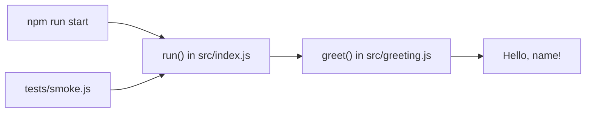

# demo-node architecture

## System boundary

Node.js ES module. The CLI entry point is `src/index.js`; the package has no external dependencies or persistent storage.

## Component map

The arrows follow the direct imports and calls in the source. `run()` supplies its default name; `greet()` normalizes the value and formats the string.

## Module inventory

| Module | Initial observation | Note |
|---|---|---|
| `src/index.js` | CLI entry point and public `run(name)` wrapper. | [[modules/src]] |
| `src/greeting.js` | Converts input to trimmed text and formats the greeting. | [[modules/src]] |
| `tests/smoke.js` | Checks default and named `run()` results. | [[modules/src]] |

## Data flow and important paths

The CLI path writes one line to stdout. The imported `run()` path has no I/O; `greet()` has no external side effects.
