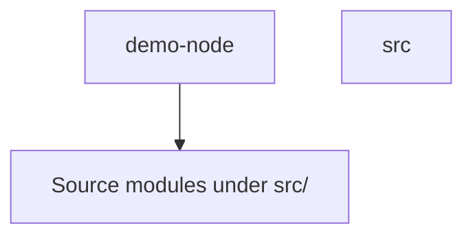

# demo-node architecture

## System boundary

Detected stack: Node.js / JavaScript or TypeScript. Entry points and external boundaries must be confirmed by reading the source and runtime configuration.

## Component map

The diagram groups files by their first-level directory under `src\`. It does not claim runtime call direction.

## Module inventory

| Module | Initial observation | Note |
|---|---|---|
| src | Bootstrap inventory; responsibility needs source review. | [[modules/src]] |

## Data flow and important paths

Not established by manifest/file-name scanning. Trace the entry point and side effects before adding arrows or documenting runtime behavior.