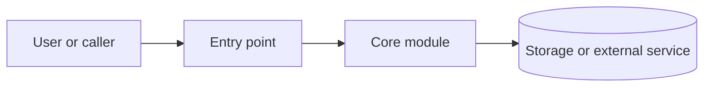

# {{project_name}} architecture

## System boundary

Describe the process boundary, external services, storage, and main entry points.

## Component and data flow

Replace this example with components and arrows found in the source. Label assumptions and asynchronous boundaries.

## Important flows

1. Name the triggering input.
2. Follow the data through the relevant modules.
3. Record side effects and failure handling.

## Module notes

| Module | Responsibility | Note |
|---|---|---|

## Boundaries and risks

Record coupling, runtime configuration, or areas where a small change has broad effects.
